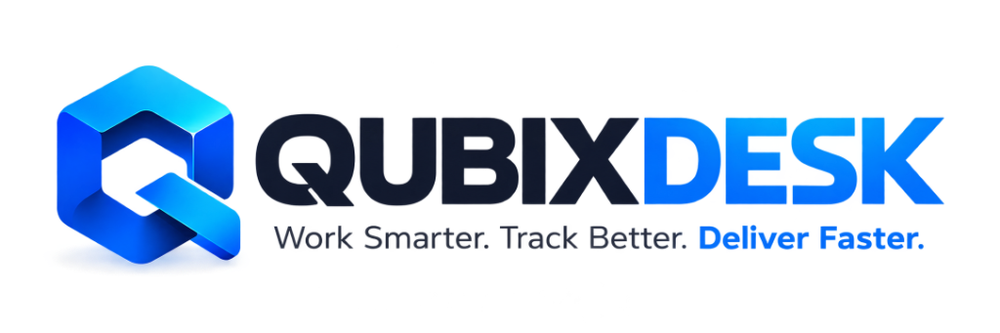

<p align="center">
  
</p>

<h3 align="center">Enterprise Multi-Tenant Project & Issue Ticketing SaaS Platform</h3>

<p align="center">
  <strong><em>"Work Smarter. Track Better. Deliver Faster."</em></strong>
</p>

<p align="center">
  <a href="#-dedicated-authentication-portals--demo-credentials">Demo Logins</a> •
  <a href="#-key-product-capabilities">Key Features</a> •
  <a href="#-getting-started">Quickstart</a> •
  <a href="#-testing-multi-tenant-isolation">Security Tests</a> •
  <a href="#-technology-stack-summary">Tech Stack</a>
</p>

---

QubixDesk is a production-grade, multi-tenant Software-as-a-Service (SaaS) platform built for high-velocity software engineering companies, IT service providers, digital agencies, and enterprise teams to manage projects, track issues, assign ownership, collaborate with real-time updates, and resolve tickets with full operational visibility.

---

## 🌐 Production Live Deployment (qubixdesk.toolio.tech)

QubixDesk is configured and production-ready for live deployment:
- **Live Subdomain**: [https://qubixdesk.toolio.tech](https://qubixdesk.toolio.tech)
- **Production Server IP**: `2.25.126.135`
- **DNS Record**: `qubixdesk` -> `A` record pointing to `2.25.126.135` (Active on `toolio.tech`)

---

## 🔐 Dedicated Authentication Portals & Credentials

QubixDesk enforces strict isolation between **Organization Workspace Users** and **Platform Super Administrators**.

### 1. Platform Super Admin Security Console (Isolated)
- **Production URL**: [https://qubixdesk.toolio.tech/admin/login](https://qubixdesk.toolio.tech/admin/login)
- **Local Dev URL**: [http://localhost:5173/admin/login](http://localhost:5173/admin/login)
- **Scope**: Completely isolated security console for SaaS platform operators and system owners. Normal workspace users have zero navigation or links leading to this console.
- **Features**: Global MRR telemetry, platform subscription analytics, cross-tenant organization suspension/reactivation, platform user inspection, and global audit trails.

| Role | Email | Password | Console Access |
|---|---|---|---|
| **Platform Super Admin** | `admin@qubix.io` | `Password123!` | `/admin` |

---

### 2. Organization Workspace Registration & Login
- **Production URL**: [https://qubixdesk.toolio.tech/login](https://qubixdesk.toolio.tech/login)
- **Registration**: [https://qubixdesk.toolio.tech/register](https://qubixdesk.toolio.tech/register) with instant 14-day Full Access Free Trial.
- **Scope**: Clean unified portal where any real business or organization creates their workspace and logs in with their own accounts.
- **Demo Data Status**: All sample/mock organizations and demo tickets have been completely purged for a clean production start. New organizations onboard with real data, real email verification, and real team invites.

---

## 🚀 Streamlined 3-Step Organization Onboarding

1. **Step 1: Administrator Profile Info**
   - Full Name
   - Contact Phone Number
   - Job Title / Role
   - Department

2. **Step 2: Company Information**
   - Company / Organization Name
   - Industry & Organization Size
   - Company Website (optional)
   - *Workspace slug is automatically generated from the company name — no manual URL configuration step required.*
   - *14-Day Free Trial with Full Platform Access is automatically activated — no plan selection step required.*

3. **Step 3: Project & Team Launch**
   - Primary Project Name & Key Prefix (e.g. `CORE`, `DEV`)
   - Invite Colleague Emails (optional)
   - One-click launch into the live workspace!

---

## 💳 Plan Quotas & Automatic Trial Fallback

QubixDesk enforces dynamic resource quotas and feature gating across the lifecycle of each organization:

- **14-Day Free Trial (Active)**:
  - **Full Platform Access**: Up to 50 team members, 25 projects, 10,000 tickets, automated workflows, custom SLA policies, and 1-click analytics exports.
  - Zero upfront credit card required.

- **Automatic Free Plan Fallback (Trial Expired)**:
  - When the 14-day trial concludes without an upgraded subscription, the workspace automatically falls back to the **Free Tier**.
  - **Resource Quotas**: Max 3 team members, 2 active projects, 50 tickets, and standard Kanban views.
  - Advanced workflows and custom SLA rules are locked until an upgrade is selected.

- **Paid Scale Tiers**:
  - **Starter** (\$19/mo): 5 team members, 5 active projects, 500 tickets, standard automations.
  - **Professional** (\$49/mo): 25 team members, 20 active projects, 5,000 tickets, full automations, custom SLA.
  - **Business** (\$129/mo): 100 team members, 100 active projects, 50,000 tickets, audit logs, 99.9% uptime SLA.
  - **Enterprise** (\$399/mo): Unlimited members, unlimited projects, unlimited tickets, dedicated support.

---

## 🌟 Key Product Capabilities

### 1. True Multi-Tenant Architecture & Data Isolation
- **Tenant Context**: Every organization has a unique slug and tenant ID (`organizationId`).
- **Middleware Isolation**: Backend middleware (`tenantContext`) validates tenant membership and injects `organizationId` directly into Mongoose queries (`tenantScope`). Cross-tenant leakage is strictly prevented at the database query level.
- **8-Tier Role-Based Access Control (RBAC)**:
  1. `super_admin`: Global platform operator.
  2. `owner`: Tenant account owner with billing and member rights.
  3. `admin`: Tenant administrator.
  4. `project_manager`: Project creator, assigner, and milestone manager.
  5. `team_lead`: Technical leader, ticket reviewer, workflow operator.
  6. `employee`: Software developer or staff member working on assigned tickets.
  7. `reporter`: External client or customer submitting issues.
  8. `viewer`: Read-only stakeholder.

### 2. Live Interactive Kanban Board
- **Visual Identity**: Clean card layout, subtle elevation, status indicators (`To Do`, `In Progress`, `Resolved`).
- **Drag & Drop**: Instant status transitions with optimistic UI rendering.
- **Real-Time Collaboration**: Powered by Socket.IO (`org_${id}` rooms) — changes sync across teammates' screens without refreshing.

### 3. Ticket Details Drawer (Slide-Out Inspector)
- Click any ticket from any view to open the right-side inspector without losing your work context.
- **Header**: Ticket identifier (e.g. `QUB-000101`), title, project, assignee, priority tag, status dropdown.
- **Tabs**:
  - 💬 **Public Comments**: Team and client discussions with timestamps and user avatars.
  - 🔒 **Internal Notes**: Restricted strictly to internal team members (hidden from external clients/reporters).
  - 📎 **Attachments**: Cloud-backed file uploads powered by Cloudinary object storage with local disk fallback.
  - 📜 **Activity Timeline**: Complete chronological audit trail tracking who changed what and when.

### 4. Automated Workflow Engine
- Configure conditional automations without writing code:
  - **Triggers**: Priority escalated to Critical/Urgent, Ticket Created, Ticket Resolved.
  - **Actions**: Auto-assign to Team Lead, dispatch push notification, send email alert, tag `#escalated`.

### 5. SLA Analytics & Executive Reports
- Visual velocity trends, SLA compliance tracking, category breakdowns, and workload distributions.
- **Exporting**: One-click export to **CSV** and formatted **PDF** via jsPDF.

### 6. Billing & Subscription Management
- Pre-configured subscription plans:
  - **Starter**: \$19/month (up to 5 team members).
  - **Professional**: \$49/month (up to 25 team members).
  - **Business**: \$129/month (up to 100 team members).
  - **Enterprise**: \$399/month (unlimited members, custom SLA, dedicated support).
- Seat usage tracking, plan upgrade dialogs, and invoice history.

---

## 🚀 Getting Started

### Prerequisites
- **Node.js**: v18.0.0+ (Tested on Node v22.19.0)
- **npm**: v9.0.0+
- **MongoDB Atlas** or local MongoDB instance (Embedded in-memory MongoDB fallback supported automatically if URI is omitted).

### 1. Clone & Install
```bash
git clone https://github.com/Manishmatre/QubixTicketing.git
cd QubixTicketing
npm install
```

### 2. Environment Configuration

The server environment file is located at `server/.env`:
```env
PORT=4000
NODE_ENV=development
MONGO_URI=mongodb+srv://<username>:<password>@cluster0.vnevj1u.mongodb.net/QubixTicketing?retryWrites=true&w=majority
JWT_SECRET=qubix_super_secret_jwt_key_2026_enterprise_saas
JWT_REFRESH_SECRET=qubix_super_secret_refresh_jwt_key_2026_enterprise_saas
JWT_EXPIRES_IN=15m
JWT_REFRESH_EXPIRES_IN=7d

# Cloudinary Object Storage
CLOUDINARY_CLOUD_NAME=deekt4ncx
CLOUDINARY_API_KEY=338921665685543
CLOUDINARY_API_SECRET=YaC6R_YN8PghLGY2pK4phK3Gj5A
```

The client environment file is located at `client/.env`:
```env
VITE_API_URL=/api/v1
VITE_SOCKET_URL=http://localhost:4000
```

### 3. Start Development Servers

Start both servers concurrently from the root directory:
```bash
# Terminal 1: Backend Server (runs on Port 4000)
npm run dev:server

# Terminal 2: Frontend Vite Client (runs on Port 5173 with API proxy)
npm run dev:client
```

Now open [http://localhost:5173](http://localhost:5173) in your browser!

---

## 🧪 Testing Multi-Tenant Isolation

QubixDesk includes an automated test suite verifying cross-tenant isolation and security:

```bash
npm run test:server
```

**Test Coverage**:
- ✅ Cross-tenant data leakage prevention (Tenant A cannot read Tenant B's tickets).
- ✅ Internal notes protection (External reporters cannot access internal notes).
- ✅ Role-based permission enforcement (Viewers cannot delete projects).
- ✅ Platform Super Admin isolation (Workspace tokens cannot access `/admin` APIs).

---

## 🏗️ Technology Stack Summary

| Layer | Technologies |
|---|---|
| **Frontend** | React 18, Vite, TypeScript, Tailwind CSS, Framer Motion, Lucide React, React Router v7, TanStack Query, Recharts, jsPDF |
| **Backend** | Node.js, Express.js, TypeScript, Mongoose, Socket.IO, JWT Auth, Multer, Helmet, Nodemailer, Cloudinary SDK |
| **Database** | MongoDB Atlas with Mongoose schema validation & compound multi-tenant indexing |
| **DevOps & QA** | Vitest, Supertest, MongoMemoryServer, Docker, Docker Compose, Nginx |

---

## 📂 Project Directory Structure

```text
Qubix/
├── client/                     # Vite + React + TypeScript Frontend
│   ├── src/
│   │   ├── api/                # Axios API client & typed endpoints
│   │   ├── components/         # Kanban, Drawer, Workflows, Modals, Navbar
│   │   ├── context/            # AuthContext, TenantContext, SocketContext
│   │   ├── pages/
│   │   │   ├── admin/          # SuperAdminLoginPage, SuperAdminView
│   │   │   ├── auth/           # Workspace LoginPage, RegisterPage
│   │   │   ├── onboarding/     # Multi-step Workspace Setup Wizard
│   │   │   ├── public/         # Landing, Features, Solutions, Comparison, Pricing, Demo
│   │   │   └── workspace/      # Dashboard, Kanban, Tickets, Teams, Reports
│   │   ├── App.tsx             # Route definitions & guards
│   │   └── main.tsx            # App bootstrap
│   └── vite.config.ts          # Reverse proxy to backend port 4000
│
├── server/                     # Express + TypeScript REST API & Socket.IO
│   ├── src/
│   │   ├── config/             # DB & Cloudinary storage configuration
│   │   ├── controllers/        # Auth, Tenant, Ticket, Project, Admin
│   │   ├── middleware/         # authMiddleware, tenantContext, rbacGuard
│   │   ├── models/             # Organization, User, Project, Ticket, Plan
│   │   ├── routes/             # Versioned REST API endpoints (/api/v1)
│   │   ├── services/           # Socket.IO & Cloudinary Storage Adapter
│   │   ├── tests/              # Multi-tenant isolation test suite
│   │   └── server.ts           # HTTP server, WebSocket boot & seeder
│   └── package.json
│
├── package.json                # Monorepo workspaces
└── README.md                   # Complete documentation
```

---

## 🛠️ Production Server Deployment (qubixdesk.toolio.tech)

To deploy or update QubixDesk on your server (`2.25.126.135`):

### 1. SSH into your Server
```bash
ssh root@2.25.126.135
```

### 2. Clone / Pull Repository
```bash
cd /var/www/qubixdesk    # or your project directory
git pull origin main
```

### 3. Install Dependencies & Build
```bash
npm install
npm run build
```

### 4. Setup Nginx Reverse Proxy
```bash
sudo cp deploy/nginx-qubixdesk.conf /etc/nginx/sites-available/qubixdesk.toolio.tech
sudo ln -sf /etc/nginx/sites-available/qubixdesk.toolio.tech /etc/nginx/sites-enabled/
sudo nginx -t
sudo systemctl reload nginx
```

### 5. Secure with Free HTTPS (Let's Encrypt / Certbot)
```bash
sudo certbot --nginx -d qubixdesk.toolio.tech
```

### 6. Start API with PM2 Process Manager
```bash
pm2 start ecosystem.config.cjs --env production
pm2 save
pm2 startup
```

---

## 📄 License

MIT © [QubixDesk Technologies](https://qubixdesk.io)
